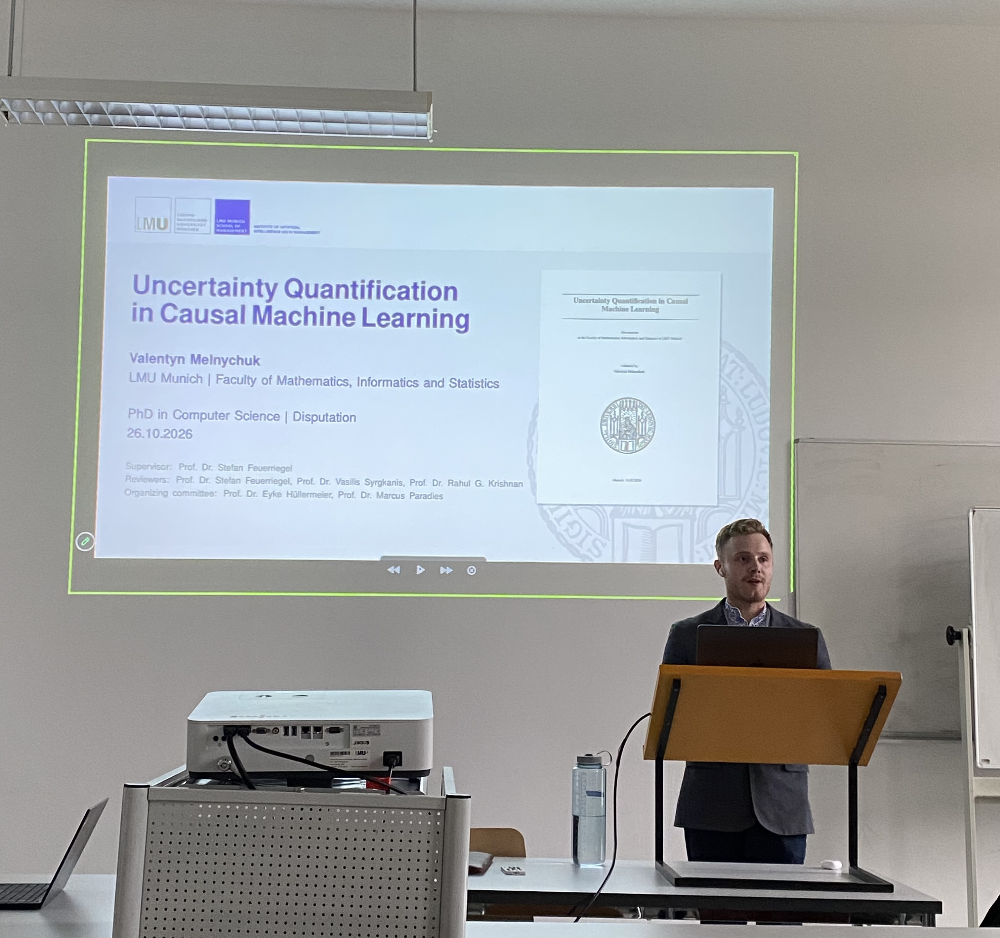
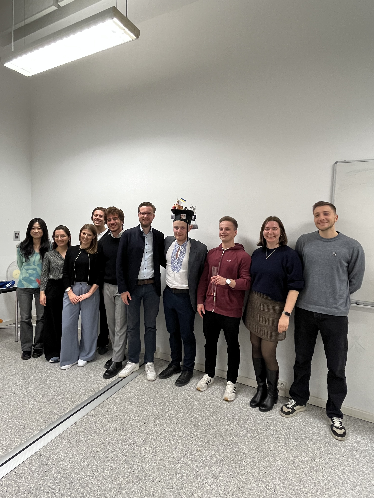
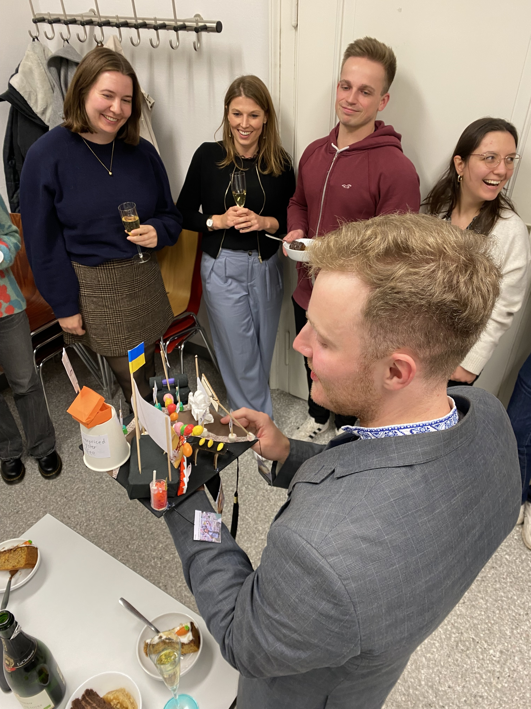
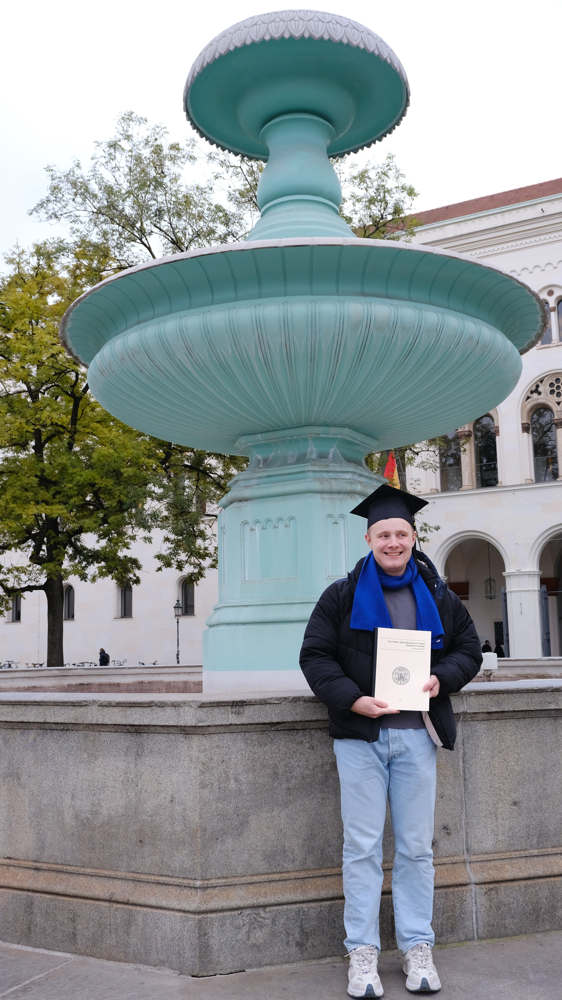

**Title**: Uncertainty Quantification in Causal Machine Learning

Disputation for the degree of PhD in Computer Science, defending my dissertation *Uncertainty Quantification in Causal Machine Learning*. The talk covers the three sources of uncertainty in causal ML — epistemic uncertainty, aleatoric uncertainty, and uncertainty due to unobserved variables — and the methods I developed for quantifying the latter two.

**Supervisor**: Prof. Dr. Stefan Feuerriegel\
**Reviewers**: Prof. Dr. Stefan Feuerriegel, Prof. Dr. Vasilis Syrgkanis, Prof. Dr. Rahul G. Krishnan \
**Organizing committee**: Prof. Dr. Eyke Hüllermeier, Prof. Dr. Marcus Paradies\
**Reference**: [https://edoc.ub.uni-muenchen.de/37918/](https://edoc.ub.uni-muenchen.de/37918/)

